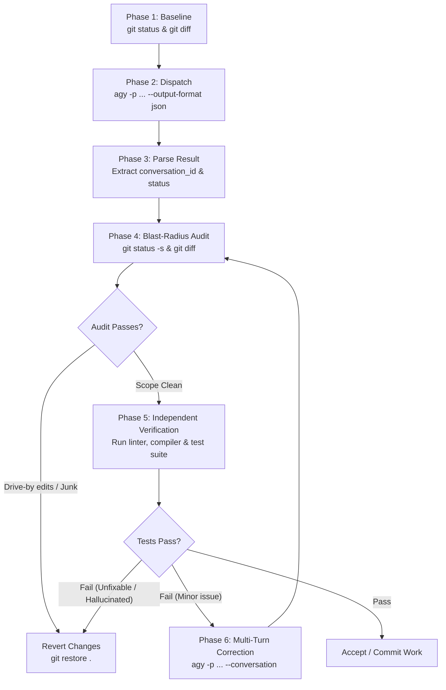

# Headless `agy` Subagent & Oversight Protocol

Delegate bounded programming, exploration, and refactoring tasks headlessly to the Antigravity CLI (`agy`) as an autonomous subagent, while strictly supervising its work.

`agy` is fast and capable of manipulating local codebases, running shell commands, and leveraging AI models across Gemini and Claude. However, **`agy` is inherently careless when left unsupervised**: it frequently claims tasks are complete without running tests, introduces drive-by refactorings, leaves stubbed-out methods (`TODO`, `pass`, empty handlers), swallows errors, or modifies files outside the designated scope.

As the orchestrating agent, **you must never take `agy`'s verbal word for success**. You treat `agy` as an eager junior contractor: give it tightly scoped instructions, run it with headless flags, audit its blast radius via `git diff`, run tests independently, and either demand fixes via multi-turn continuation (`--conversation <id>`) or immediately revert its changes.

---

## When to Use

- **Offloading Bounded Implementation**: Boilerplate generation, translating types, scaffolding test files, implementing self-contained modules or utility functions.
- **Heavy Codebase Exploration**: Delegating complex searches or file surveys to `agy` so your own primary context window remains clean.
- **First-Pass Refactoring**: Asking `agy` to apply a repetitive mechanical edit across specific files.
- **Automated Multi-Agent Pipelines**: Calling `agy` from scripts or external harnesses to run isolated coding sessions.

### When NOT to Use

- **High-Risk Core Architecture**: Authentication, crypto, schema migrations, and cross-cutting security boundaries should be handled directly by the orchestrating agent.
- **Ambiguous or Exploratory Design**: If requirements require human interview or delicate product judgment, do not hand them to headless `agy`.
- **Trivial Single-Line Fixes**: Invoking a subagent process takes 15–30 seconds of model boot and token generation. Direct edits in the main agent are faster and cheaper.

---

## The Non-Negotiable Discipline (5 Trust-Nothing Axioms)

1. **Zero Unverified Trust (The Golden Rule)**:
   - If `agy` outputs *"I have implemented the feature and all tests pass"*, treat this statement as ungrounded until **you** run the test suite and verify the exit code yourself.
   - `agy`'s response string is a claim; `git status`, `git diff`, and compiler/test exit codes are reality.
2. **Blast-Radius Containment**:
   - Establish a clean git baseline before invocation (`git status`).
   - If `agy` touches a single file outside the designated scope, flag it as a violation. Reject or revert drive-by edits.
3. **Machine-Parseable Contract**:
   - Always run headless invocations with `--output-format json` and `--dangerously-skip-permissions`.
   - Never run interactive prompts that hang waiting for TTY inputs.
4. **Independent Verification Floor**:
   - The orchestrating agent (or calling harness) executes the project's linter, compiler (`tsc`, `mypy`, `cargo check`), and test suite (`pytest`, `npm test`, `go test`). Never rely on `agy`'s internal tool outputs alone.
5. **Revert-on-Red**:
   - If `agy` fails verification, breaks tests, or generates unfixable garbage, run `git restore <files>` / `git checkout -- <files>` immediately. Do not build upon a compromised foundation.

---

## The Headless Invocation Recipe

### Core CLI Command

```bash
agy -p "<PROMPT>" \
  --output-format json \
  --dangerously-skip-permissions \
  --print-timeout 300s
```

### Essential CLI Flags

| Flag | Purpose | Recommended Value |
| :--- | :--- | :--- |
| `-p`, `--print` | Runs the prompt non-interactively and exits. | Required. Pass the task prompt. |
| `--output-format` | Formats stdout output. | `json` (returns structured JSON payload). |
| `--dangerously-skip-permissions` | Auto-approves tool calls (file edits, bash execution) without interactive prompts. | **Mandatory** for headless automation. |
| `--print-timeout` | Maximum wait duration before killing process. | `180s` to `600s` (prevents infinite loops). |
| `--model` | Selects reasoning model. | `gemini-3.8-flash-high` (fast/thorough), `gemini-3.1-pro-high` (complex logic), `claude-sonnet-4-6`. |
| `--effort` | Reasoning effort depth. | `medium` or `high` for non-trivial logic. |
| `--mode` | Agent execution mode. | `accept-edits` (default for code changes), or `plan` (read-only work plan). |
| `--conversation` | Resumes an existing session ID for multi-turn iterative fixes. | Pass `<conversation_id>` from previous output. |
| `--add-dir` | Mounts additional directories into the workspace. | Optional path. |

### JSON Output Structure

When `--output-format json` is specified, `stdout` produces a single JSON object upon completion:

```json
{
  "conversation_id": "a43c1f93-2e9f-46bf-823d-285f492137ea",
  "status": "SUCCESS",
  "response": "Summary of changes made...",
  "duration_seconds": 18.46,
  "num_turns": 1,
  "usage": {
    "input_tokens": 19662,
    "output_tokens": 140,
    "thinking_tokens": 139,
    "total_tokens": 19802
  }
}
```

- **`conversation_id`**: Retain this! If `agy` makes a careless mistake, resume the conversation using `--conversation <conversation_id>` to deliver precise corrective instructions without losing previous context.
- **`status`**: `"SUCCESS"` or `"ERROR"`. Note: `"SUCCESS"` only indicates the CLI process did not crash; it does **not** indicate the code is correct.

---

## Prompt Engineering for Careless Subagents

When delegating to `agy`, fuzzy prompts produce careless code. Wrap all requests in a **Contract Prompt**:

```text
You are a headless subagent tasked with: <EXACT_OBJECTIVE>.

SCOPE BOUNDARY:
- Target files: <EXPLICIT_PATHS>
- Do NOT touch or reformat any files outside of the target list.
- Do NOT add new dependencies without explicit permission.

MANDATORY RULES:
1. Implement complete logic. Do NOT leave TODOs, pass statements, or dummy placeholders.
2. Preserve all existing comments, docstrings, and formatting conventions.
3. Run `<VERIFICATION_COMMAND>` to verify your changes before finishing.
4. Output a summary listing: (a) files changed, (b) commands run, and (c) verification output.
```

---

## The 6-Phase Supervision Lifecycle



### Phase 1: Establish Git Baseline
Ensure working tree is clean or stashed before delegating:
```bash
git status -s
```
*Never dispatch a headless subagent into a dirty working tree, or you will not be able to isolate its diff.*

### Phase 2: Dispatch Headless `agy`
Execute the task non-interactively using the CLI wrapper or direct bash:
```bash
agy -p "Implement health check endpoint in src/server.py and test in tests/test_server.py" \
  --output-format json \
  --dangerously-skip-permissions \
  --print-timeout 300s > agy_result.json
```

### Phase 3: Blast-Radius Audit
Inspect what files `agy` actually created or modified:
```bash
git status -s
```
**Check**:
- Did `agy` create unexpected scratch files, logs, or unrequested configs?
- Did `agy` touch files outside the agreed scope?
If unauthorized files are modified, run `git restore <unauthorized_files>` or `rm <untracked_files>` immediately.

### Phase 4: Diff Review
Inspect the precise diff of what `agy` wrote:
```bash
git diff
```
**Carelessness Checklist**:
- [ ] Are there stubbed functions (`pass`, `// TODO`, `throw new Error("Not implemented")`)?
- [ ] Did `agy` delete existing comments, docstrings, or type annotations?
- [ ] Did `agy` silence the typechecker (`as any`, `@ts-ignore`, `# type: ignore`)?
- [ ] Did `agy` relax assertions or delete existing test cases?

### Phase 5: Independent Verification Floor
Run the project's test and build tools directly:
```bash
# Examples:
pytest tests/
bun test
cargo test
npm run typecheck
```
If exit code != 0, the task is **not done**, regardless of what `agy` claims in `response`.

### Phase 6: Corrective Iteration or Revert
- **For minor defects**: Resume the conversation with targeted feedback:
  ```bash
  agy -p "Your change broke test_timeout in tests/test_server.py with AttributeError. Fix it without changing test assertions." \
    --conversation "<conversation_id>" \
    --output-format json \
    --dangerously-skip-permissions
  ```
- **For severe deviations**: Revert cleanly and terminate delegation:
  ```bash
  git restore .
  git clean -fd
  ```

---

## Detailed References & Tooling

- [Headless CLI Reference](file:///home/etirnal/GIT/skillet/skills/headless-agy/references/cli-reference.md): Detailed CLI options, schema enforcement, model selection matrix, and timeout rules.
- [Carelessness Catalog & Detection](file:///home/etirnal/GIT/skillet/skills/headless-agy/references/carelessness-catalog.md): The anatomy of `agy` careless mistakes, automated detection regexes, and prompt counter-measures.
- [Verification & Transcript Audit](file:///home/etirnal/GIT/skillet/skills/headless-agy/references/verification-protocol.md): How to audit raw tool-call transcripts located at `~/.gemini/antigravity-cli/brain/<conversation_id>/.system_generated/logs/transcript.jsonl`.
- [Subagent Helper Script](file:///home/etirnal/GIT/skillet/skills/headless-agy/scripts/agy_subagent.py): Zero-dependency Python utility for executing headless `agy` jobs with automated git diffing and verification bundles.
